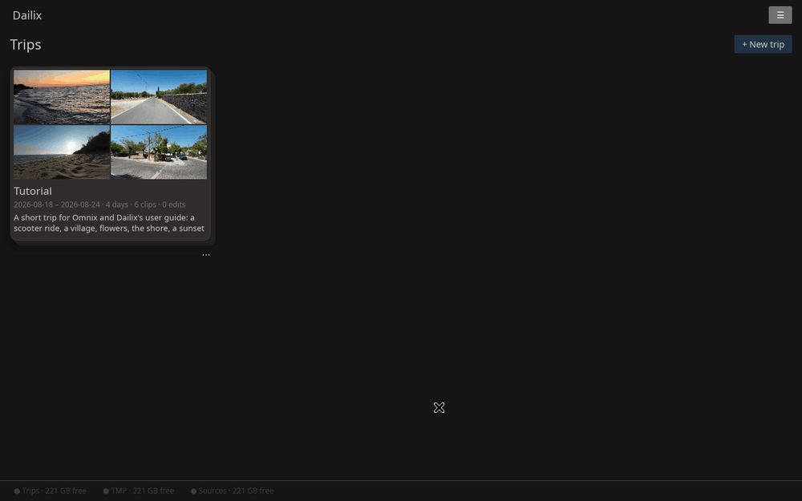

# Dailix

Bringing footage in and choosing it. *Dailies* is the trade's word for a
day's raw footage, looked through and sorted before the edit: Dailix
takes it off cards and phones, lets you look through it and mark what's
worth keeping, files the originals away, and hands the chosen material to
an editor ([Omnix](https://github.com/nedcrest/omnix-360-studio)). Rust, built the way Omnix is.



Status: the contact sheet works (Home of trip cards, a trip's page,
days, rating, segments, flags, the player, «→ Omnix»), on a core with a
command line; it replaces footage-agent's web contact sheet. A trip holds
its edits, each with its exports; a new trip is made here.
Bringing footage in is designed (`docs/INGEST.md`), not built.

**New here? Read [the guide](https://github.com/nedcrest/omnix-360-studio/blob/main/docs/guide/README.md)**
(it lives in Omnix's repository, for both programs): installing, a
tutorial from a trip's clips to a finished film, and every key, command
and setting ([Dailix's keys](https://github.com/nedcrest/omnix-360-studio/blob/main/docs/guide/keys-dailix.md),
[commands](https://github.com/nedcrest/omnix-360-studio/blob/main/docs/guide/commands-dailix.md)).

## Three places

Dailix works across three places, each set in its settings (its first
run offers `~/Dailix/trips`, `tmp` and `sources`):

```text
Trips      a folder per trip, with the clips chosen for it, its marking
           and its edits (the command line calls it «projects»)
TMP        where new material lands first, straight off a card or a phone,
           checked, before anything is decided about it
Sources    every original, kept as it came off the camera, never changed,
           filed by trip and day; one copy now, two some day
```

**Sources can live anywhere a folder can:** a local disk, a removable
drive, a network share (mounted as a folder). A cloud bucket is planned:
the setting names a kind and a place, so a bucket becomes one more kind
rather than a change everywhere.

## What it does, in order

1. **Bring in.** Media from a card, a phone or a folder are copied into
   TMP and checked against the source (sizes, then hashes). The card is
   left as it was.
2. **Choose.** The contact sheet shows a day's clips as tiles: rate each
   (✓ take, ? think, ✕ junk), note it, mark segments (in and out, a role
   such as *B-roll* or *talk*, a note), flag what needs finding (a meme, a
   sound), and write the day's story.
3. **File away.** The originals move from TMP into sources, by trip and
   day, unchanged.
4. **Hand over.** The chosen clips go into a trip in Trips, and an
   Omnix edit is made from the marking (Omnix reads the marking itself
   too: segments set in its bin land in the same file).

## A project folder

The numbered folders are for people, opened in a file manager; everything
a program keeps lives in `dailix/` beside them.

```text
<project>/
  01_footage/<day>/<clip>    the clips chosen for this project (copies)
  02_audio/music, 02_audio/voiceover
  03_proxies/<day>/<clip>    light copies for quick editing (none made yet)
  videos/<name>/             a video of the trip: edit.json (Omnix's edit)
                             and export/ (its finished files)
  06_external                outside video: memes, inserts, transitions
  07_sfx                     sound effects
  08_pictures                pictures and photos over the video (an old 08_graphics still read)
  09_luts                    colour LUTs (.cube)
  dailix/
    project.json             what the project is, where it came from
    sheet.json               the marking: days, ratings, notes, segments
    analysis/<day>/<clip>.footage.json
    thumbs/<day>/<clip>.jpg  a poster per clip, made when first shown
    voice/<day>/<clip>/<recipe>.flac   cleaned voices
```

A clip is named in the marking by its path under `01_footage`:
`<day>/<file>`.

## Command line

```text
dailix                         the window, where it was left (Home the first time)
dailix open <project>          the window on that project
dailix new-trip [title]        a new trip in the projects place (no title: the form)
dailix places [...]            the three places: shows them, or sets those given
dailix trips                   the trips and their days, as Home sums them up
dailix title <project> [name]  a project's name as people say it
dailix tidy-edits <project>    old loose edits moved into videos/<name>/ (--apply)
dailix import-legacy <old>      a footage-agent project made into a Dailix one
dailix sheet apply <sheet> <ops.json|->   change a marking: checked, all or none
dailix sheet check <sheet>     what's wrong with a marking
dailix sheet describe <sheet>  a marking as text, a line per clip and segment
dailix sheet schema [ops|sheet]
dailix install                 the icon and a desktop entry (Linux; Omnix's installer)
```

The marking's format and the ops that change it: Omnix's `docs/SHEET-CORE.md` (the sheet core, `crates/sheet`, lives in Omnix's repo).
Where the project stands and what's next: `docs/CONTEXT.md`.

## Building

Dailix builds against Omnix (its player and sound tools) and the contact
sheet's core, both in Omnix's repo: clone the two side by side, Omnix's
folder named `omnix-360-studio` (Dailix finds it at
`../omnix-360-studio`).

```sh
git clone https://github.com/nedcrest/omnix-360-studio && git clone https://github.com/nedcrest/dailix
sudo apt install pkg-config libasound2-dev ffmpeg   # Debian/Ubuntu
cd dailix && cargo build --release && cargo test
```

CI (`.github/workflows/ci.yml`) checks Omnix out beside it the same way.

## Built with AI

Dailix, and everything Omnix added to rOsmo360 since forking it, were
built by one person working with Claude: how, and the rules that kept it
sound, in Omnix's `docs/AI-DRIVEN.md`. Dailix plays 360 clips through
Omnix, whose 360 playback is
[rOsmo360](https://github.com/ravelund/rOsmo360)'s, by Vibing with
Ravelund.

## Licence

MIT OR Apache-2.0, at your option (`LICENSE-MIT`, `LICENSE-APACHE`).
